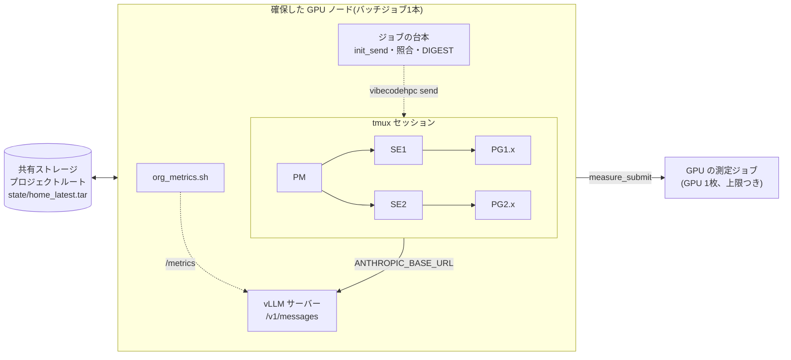

# サンプル: HPC のジョブ1本の中で自前の推論と VibeCodeHPC の組織を動かす

組織の全体を、スーパーコンピュータのバッチジョブ1本の中で動かす。確保したノードの GPU で自前の推論エンジンを立て、PM・SE・PG(tmux の中の Claude Code)は `127.0.0.1` のそのサーバーと話す。外へ何も出ないので、計算ノードがインターネットにつながらず SSH でも入れない環境で使える。次のバッチジョブは同じ会話を続ける。

台本一式は [docs/samples/self_hosted_inference_on_hpc/](../self_hosted_inference_on_hpc/) にある(英語版 README も同じ場所)。役割の指示書と adapter は変えない。

## 構成



ジョブをまたぐ流れ:


## ファイル

| ファイル | 役目 |
|---|---|
| `run_org_pbs.sh` | PBS のジョブ台本。ヘッダとジョブ ID を決めて `org_job.sh` を読み込む |
| `run_org_slurm.sh` | 同じものの Slurm 版の骨子(Slurm のサイトではまだ動かしていない) |
| `org_job.sh` | ジョブの本体。サーバー、プロジェクトの木、HOME、v2 の起動か再開、常駐の loop、状態の保存 |
| `serve.sh` | Anthropic 互換のエンドポイントを持つ vLLM サーバー。投機デコードは引数 |
| `resume_sessions.py` | 新しいジョブで tmux セッションを作り直し、全員の会話を再開する |
| `init_send.py` | 各ワーカーに最初の(または「新しいジョブ」の)指示を `vibecodehpc send` で1回だけ送る |
| `digest_from_verified.py` | 独立した照合が通した行だけから、順位つきの `User-shared/DIGEST.md` を作る |
| `measure_submit.sh` | エージェントが小さな GPU 測定ジョブを決まった上限の内で出す |
| `org_metrics.sh` | サーバーの `/metrics` と GPU の使用量を JSONL に取る |
| `org_summary.py` | 1ジョブで組織が何をしたかをファイルから数える |
| `remote_info_example/` | エージェントがノード上で直に動くときの `_remote_info/<site>/` のひな形 |

パッケージ側の `vibecodehpc/scripts/seed_claude_home.py` と `vibecodehpc/hooks/templates/claude/deny_media_read.py` も使う。

## 使い方

1. 共有ストレージに用意する:
   - VibeCodeHPC の checkout(このリポジトリ)
   - モデルの重みと、vLLM の環境かコンテナイメージ(`LLM_CONTAINER`)
   - ノードのアーキテクチャ用の Claude Code の実行ファイル(`VCHPC_CLAUDE_BIN`)
   - Python 3.10 以上(`VCHPC_PYTHON`)
   - 入力ディレクトリ: `requirement_definition.md`、`BaseCode/`、`_remote_info/<site>/`(`remote_info_example/` から作る)
2. `run_org_pbs.sh` のヘッダ(キュー、walltime、課金)を書き換え、モデルに合うサーバーの設定を選ぶ(`serve.sh` 参照)。ツール呼び出しのパーサー(`LLM_TOOL_PARSER`)は必須。無いとエージェントは何もできない。
3. このディレクトリから投入する:

   ```bash
   cd docs/samples/self_hosted_inference_on_hpc
   V=VCHPC_RUN_DIR=/shared/me/run,VCHPC_INPUT_DIR=/shared/me/inputs,VCHPC_WALL_SEC=3600
   V=$V,LLM_MODEL=/shared/models/my-model,LLM_TOOL_PARSER=my_parser,LLM_TP=4
   qsub -v "$V" run_org_pbs.sh
   ```

4. 続けるときは同じコマンドをもう一度投入する。Claude Code は会話をディレクトリの path ごとに保存するので、プロジェクトルート(`VCHPC_RUN_DIR`)の path は変えない。

ログは `VCHPC_RUN_DIR/../joblogs/<ジョブ ID>/` に残る: `server.log`、`kv_summary.txt`、`timing.jsonl`、`org_metrics.jsonl`、`org_summary.json`、各補助台本のログ。

### `requirement_definition.md` に足すこと

役割の指示書はログインノード、SSH、バッチスケジューラを前提にしている。指示書は要件定義を優先する作りなので、指示書は直さず差分を要件定義に書く:

```markdown
## Execution environment
- All agents run on an allocated compute node inside a batch job. Run builds and tests
  directly in your working directory. Do not use ssh, qsub or sbatch.
- The node's GPUs serve the language model. GPU measurements go through
  `measure_submit <dir> "<purpose>"` only (see _remote_info/<site>/command_list.md).
- This job ends at @JOB_END@. Stop starting new work at @STOP_NEW_WORK@.
- All agents share one local model server. Reply within 10 minutes; treat an agent
  as unresponsive only after 15 minutes without output.
- In ChangeLog, use resource_group `<queue>` and the start/end time of each run.
```

`@JOB_END@` と `@STOP_NEW_WORK@` はジョブの台本が毎回の開始時に置き換える。

## 素の v2 から外す・替える・足す所と理由

| 所 | 扱い | 理由 |
|---|---|---|
| v2 と hooks の `python3` | `VCHPC_PYTHON` への `python3` のリンクを `PATH` の先頭に置く | v2 は Python 3.10 以上が要る。ノードの python は古いことがある |
| Claude Code のつなぎ先 | `ANTHROPIC_BASE_URL`、`ANTHROPIC_AUTH_TOKEN` と全部のモデルの枠(`ANTHROPIC_MODEL`、Opus/Sonnet/Haiku の既定、`CLAUDE_CODE_SUBAGENT_MODEL`)を `setup` の前に export | v2 にこの設定口が無い。tmux が環境を全ペインに渡すので adapter は変えない |
| 初回の画面 | ノードローカルの HOME を `seed_claude_home.py` で用意 | v2 は3秒後に Enter を1回送るだけ。信頼確認は越えるが、初回案内と bypass-permissions の警告(既定の選択が終了)は越えない |
| エージェントごとの設定 dir | 分けない。HOME を1つ共有 | `context-monitor` が `~/.claude/projects/` の全会話を読む |
| tmux の画面の大きさ | `~/.tmux.conf` に `default-size 280x80` | セッションは detached の 80x24 で作られ、小さい画面では分割でペインが減る |
| 指示書の SSH とスケジューラの前提 | 指示書は変えず、差分を要件定義に書く | 指示書は要件定義を優先する作り。書き換えると素の v2 でなくなる |
| CD | 使わない | 閉じたノードに push 先が無い |
| 予算 | 時間で書き、キューの単価を `_remote_info/<site>/node_resource_groups.md` に置く | 予算の道具の既定の単価は別のシステムのもの |
| 応答の決まり(3分で ACK、5分で落ちた扱い) | 要件定義で緩める | 速いクラウドの API が前提。ここでは全員が1台のサーバーを使う |
| periodic_monitor の 120 分の打ち切り | `max_runtime_min` をジョブの窓に合わせる | 既定のままでは長いジョブの後半を見張らない |
| 会話の中の画像 | `deny_media_read.py` の hook(`--text-only`)と、サーバーの `--limit-mm-per-prompt` 0 | 文字だけのサーバーは画像を断り、画像が1つ会話に入るとその会話の以後の要求が全部失敗する。periodic_monitor が PNG の図を書き、エージェントはそれを読もうとする |
| ワーカーへの最初の指示 | `init_send.py` が1体に1回送る | 遅い PM は送るまでに15分以上かかり、その後は30秒ごとに同じ文を送り続けることがある |
| 結果の要約 | `digest_from_verified.py` が照合を通った行だけから作り、PM は1行の注だけを足す | PM の要約が、照合済みの結果が1つも無い時点で数を並べていた |
| 結果の照合 | `VCHPC_VERIFY_CMD` の loop(エージェントには読むだけ) | v2 にプログラムによる照合が無く、エージェントの自己申告だけになる |
| walltime の上限 | プロジェクトの path を固定、HOME を tar 1本に、`resume_sessions.py` | 次のジョブで同じ会話を続ける |
| PM のセッションが消えた時 | `resume_sessions.py --pm-only` を1回 | PM のセッションが無いと `setup --resume` は新規の setup に落ちる |
| GPU の測定 | `measure_submit.sh` がチームごとの上限を守らせる | ノードの GPU はサーバーのもの。上限は指示だけでなく台本で守らせる |
## 1回の実行を測る

`org_metrics.sh` と `org_summary.py` は、生成トークン、prefix cache の当たり率、KV の使用率、投機デコードの draft の位置ごとの受理、エージェントごとのターン数・ChangeLog の件数・メッセージ数を出す。サーバーの設定(例えば投機デコードの有無)を比べるときは、全部の実行を同じプロジェクトの状態と会話から始める。プロジェクトルートの tar を一度保存して `VCHPC_RUN_BASE_TAR` に渡し、`VCHPC_ORG_MIN` で窓を固定する。

サーバー側の設定(hybrid モデルの prefix cache、KV offload、effort、出力の上限)は [docs/ja/self_hosted_inference.md](../../ja/self_hosted_inference.md)。

## 確かめた環境

GPU 4枚の1ノード、1T パラメータの MoE モデルを vLLM で出し、Claude Code の PM と最大 11 体のワーカーで、PBS のシステムの連続した数本のバッチジョブにわたって動かした。Slurm の台本と `measure_submit.sh` の Slurm の分岐はまだ動かしていない。
