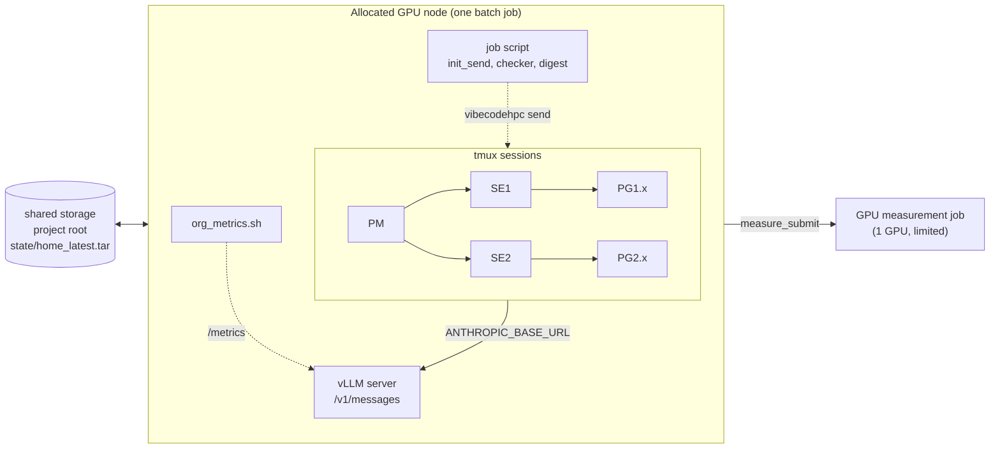
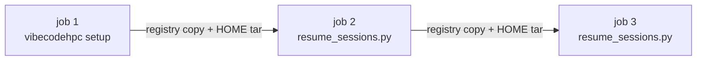

# Sample: self-hosted inference and a VibeCodeHPC organisation in one HPC job

Run the whole organisation inside one batch job on a supercomputer: your own inference engine on the allocated node's GPUs, and PM, SE and PG agents (Claude Code in tmux) that talk to it at `127.0.0.1`. Nothing leaves the node, so this works where compute nodes have no internet access and cannot be reached by SSH. The next batch job resumes the same conversations.

This sample is a kit of scripts around stock VibeCodeHPC. It does not change the role instructions or the adapters. Japanese: [../ja/self_hosted_inference_on_hpc.md](../ja/self_hosted_inference_on_hpc.md).

## Layout



Across jobs:



## Files

| File | Role |
|---|---|
| `run_org_pbs.sh` | PBS job script: header and job id, then sources `org_job.sh` |
| `run_org_slurm.sh` | Slurm skeleton of the same (not yet tested on a Slurm site) |
| `org_job.sh` | Job body: server, project tree, HOME, v2 start or resume, loops, saving state |
| `serve.sh` | vLLM server with the Anthropic-compatible endpoint; speculative decoding as an argument |
| `resume_sessions.py` | Rebuilds tmux sessions and resumes every conversation in a new job |
| `init_send.py` | Sends each worker its first (or "new job") message once, with `vibecodehpc send` |
| `digest_from_verified.py` | Ranked `User-shared/DIGEST.md` from rows an independent checker accepted |
| `measure_submit.sh` | Lets agents submit small GPU measurement jobs under fixed limits |
| `org_metrics.sh` | Samples the server's `/metrics` and GPU usage into JSONL |
| `org_summary.py` | What the organisation did in one job, counted from files |
| `remote_info_example/` | Templates for `_remote_info/<site>/` when agents run on the node itself |

Also used from the package: `vibecodehpc/scripts/seed_claude_home.py` and `vibecodehpc/hooks/templates/claude/deny_media_read.py`.

## Usage

1. Prepare, on shared storage:
   - a VibeCodeHPC checkout (this repository);
   - model weights, and a vLLM installation or container image (`LLM_CONTAINER`);
   - the Claude Code executable for the node's architecture (`VCHPC_CLAUDE_BIN`);
   - Python 3.10 or later (`VCHPC_PYTHON`);
   - an input directory with `requirement_definition.md`, `BaseCode/` and `_remote_info/<site>/` (start from `remote_info_example/`).
2. Edit the header of `run_org_pbs.sh` (queue, walltime, accounting) and choose the server settings for your model (see `serve.sh`). The tool-call parser (`LLM_TOOL_PARSER`) is required; agents cannot work without tool calls.
3. Submit from this directory:

   ```bash
   cd docs/samples/self_hosted_inference_on_hpc
   V=VCHPC_RUN_DIR=/shared/me/run,VCHPC_INPUT_DIR=/shared/me/inputs,VCHPC_WALL_SEC=3600
   V=$V,LLM_MODEL=/shared/models/my-model,LLM_TOOL_PARSER=my_parser,LLM_TP=4
   qsub -v "$V" run_org_pbs.sh
   ```

4. Submit the same command again to continue. The project root (`VCHPC_RUN_DIR`) must keep the same path, because Claude Code stores conversations per directory path.

Logs go to `VCHPC_RUN_DIR/../joblogs/<job id>/`: `server.log`, `kv_summary.txt`, `timing.jsonl`, `org_metrics.jsonl`, `org_summary.json`, and one log per helper.

### Additions to `requirement_definition.md`

The role instructions assume a login node, SSH and a batch scheduler. They defer to the requirement definition, so state the differences there instead of editing them:

```markdown
## Execution environment
- All agents run on an allocated compute node inside a batch job. Run builds and tests
  directly in your working directory. Do not use ssh, qsub or sbatch.
- The node's GPUs serve the language model. GPU measurements go through
  `measure_submit <dir> "<purpose>"` only (see _remote_info/<site>/command_list.md).
- This job ends at @JOB_END@. Stop starting new work at @STOP_NEW_WORK@.
- All agents share one local model server. Reply within 10 minutes; treat an agent
  as unresponsive only after 15 minutes without output.
- In ChangeLog, use resource_group `<queue>` and the start/end time of each run.
```

The job script replaces `@JOB_END@` and `@STOP_NEW_WORK@` at every job start.

## What changes from stock v2, and why

| Item | Treatment | Reason |
|---|---|---|
| `python3` for v2 and its hooks | A `python3` link to `VCHPC_PYTHON` first on `PATH` | v2 needs Python 3.10 or later; a node's system Python may be older |
| Claude Code endpoint | `ANTHROPIC_BASE_URL`, `ANTHROPIC_AUTH_TOKEN` and every model slot (`ANTHROPIC_MODEL`, the default Opus/Sonnet/Haiku models, `CLAUDE_CODE_SUBAGENT_MODEL`) exported before `setup` | v2 has no endpoint setting; tmux passes the environment to every pane, so the adapter stays unchanged |
| First-run screens | Node-local HOME prepared with `seed_claude_home.py` | v2 presses Enter once after 3 s. That passes the trust prompt but not onboarding or the bypass-permissions warning, whose default choice exits |
| Per-agent config dirs | Not split; all agents share one HOME | `context-monitor` reads every conversation under `~/.claude/projects/` |
| tmux window size | `default-size 280x80` in `~/.tmux.conf` | Sessions are created detached at 80x24; small windows lose panes when split |
| SSH and scheduler assumptions in the instructions | Instructions unchanged; differences stated in the requirement definition | The instructions defer to the requirement definition; editing them would make the run no longer stock v2 |
| CD agent | Off | A closed node has no push target |
| Budget | In time; the queue's rate in `_remote_info/<site>/node_resource_groups.md` | The budget tool's default rates belong to another system |
| Reply deadlines (3-min ACK, 5-min dead) | Relaxed in the requirement definition | They assume a fast cloud API; here all agents share one server |
| periodic_monitor 120-min cutoff | `max_runtime_min` set to the job's window | The default stops monitoring early in long jobs |
| Images in conversations | `deny_media_read.py` hook (`--text-only`) and `--limit-mm-per-prompt` 0 on the server | A text-only server rejects image input, and one image block makes every later request of that conversation fail. periodic_monitor writes PNG figures that agents try to read |
| First instruction to workers | `init_send.py` sends it once per worker | A slow PM may take more than 15 minutes to send it, then repeat it every half minute |
| Results summary | `digest_from_verified.py` from checker-accepted rows only; PM adds one-line notes | A PM summary listed numbers before any result had been checked |
| Checking results | `VCHPC_VERIFY_CMD` loop, read-only towards the agents | v2 has no program-side check; otherwise only the agents' own reports exist |
| Walltime limit | Fixed project path, HOME archived to one tar, `resume_sessions.py` | Continue the same conversations in the next job |
| PM session lost | `resume_sessions.py --pm-only` once | `setup --resume` falls through to a full new setup when the PM session is gone |
| GPU measurements | `measure_submit.sh` with per-team limits | The node's GPUs belong to the server; limits are enforced by a script, not only by instructions |
## Measuring a run

`org_metrics.sh` and `org_summary.py` report generated tokens, prefix-cache hit rate, KV usage, speculative-decoding acceptance per draft position, and per-agent turns, ChangeLog entries and messages. To compare server settings (for example with and without speculative decoding), start every run from the same project state and conversations: save a tar of the project root once and pass it as `VCHPC_RUN_BASE_TAR`, and fix the window with `VCHPC_ORG_MIN`.

See [docs/self_hosted_inference.md](../../self_hosted_inference.md) for server-side settings (prefix caching on hybrid models, KV offload, effort, output limits).

## Tested on

A single 4-GPU node with a 1T-parameter MoE model served by vLLM, a PM and up to 11 workers on Claude Code, over several consecutive batch jobs on a PBS system. The Slurm wrapper and the Slurm branch of `measure_submit.sh` have not been run yet.
